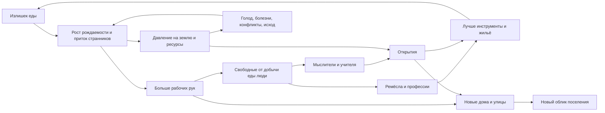

# 12. Карта взаимосвязей систем

Этот раздел — «схема шестерёнок». Каждая система обязана получать входы от других и отдавать выходы другим. Если система ни на что не влияет — она декорация и подлежит удалению.

## 12.1. Главный цикл роста

Словами: **еда → люди → свободные руки → ремесло и знание → инструменты → ещё больше еды**. Это положительная петля, которая и есть «прогресс». Её тормозят отрицательные петли: истощение округи, теснота, болезни, неравенство, войны. Игра интересна именно на стыке этих двух сил — поселение растёт рывками, с кризисами и откатами.

## 12.2. Восемь ключевых цепочек причин и следствий

**1. Еда → демография.**
Запас еды на человека — главный множитель рождаемости (раздел 4.8) и детской смертности. Два урожайных года подряд дают бэби-бум; через 8 лет эти дети начинают помогать, через 15 — становятся работниками и создают семьи, каждая из которых требует дом. Наблюдатель видит это как волну строительства спустя поколение после сытых лет.

**2. Демография → наука.**
Больше людей — это (а) больше практики, а практика двигает шкалы открытий; (б) больше шансов рождения человека с Умом 9–10; (в) выше вместимость культуры; (г) больше стариков-хранителей знаний; (д) возможность содержать тех, кто только думает. Маленькое племя может веками топтаться на месте; деревня в 80 человек делает открытие раз в несколько лет.

**3. Наука → производство → общество.**
Плуг с волом втрое увеличивает пашню на одного пахаря → освобождается часть земледельцев → они становятся ремесленниками → возникает обмен → возникает неравенство → нужны законы и власть. Технология меняет не только цифры, но и устройство общества.

**4. Наука → облик.**
Каждая технология обязана менять картинку (раздел 7.5). Бронзовый топор → срубы вместо хижин. Печь с трубой → трубы и дымки над крышами. Крашение → цветная толпа. Черепица → красные крыши волной от богатого центра к окраинам. Смена эпохи читается глазами, без единой цифры.

**5. Среда → культура.**
Биом задаёт материалы (архитектура), пищу (кухня и праздники), угрозы (чему посвящены мифы), излишки и дефициты (с кем и чем торговать, за что воевать). Одно и то же зерно мира в разных стартовых точках даёт разные цивилизации.

**6. Плотность → болезни → гигиена → планировка.**
Рост плотности без колодцев и стоков повышает шанс эпидемии квадратично. Эпидемия ускоряет открытие санитарии. Санитария переносит дубильни и кладбища, добавляет бани, стоки, мощение. Город перестраивается после собственных бед.

**7. Богатство → неравенство → политика.**
Излишек превращается в собственность, собственность — в наследство, наследство — в сословия. Рост неравенства повышает недовольство, преступность и вероятность смуты; ответом становятся законы, стража, благотворительность, а иногда — смена власти.

**8. Угрозы → сплочение и технологии.**
Волки ускоряют лук и частокол. Набеги рождают вождя и дружину. Осада ускоряет каменную кладку. Внешняя опасность повышает отношения внутри общины и авторитет воинов; долгий мир, напротив, усиливает купцов и мыслителей.

## 12.3. Матрица влияний

Читать по строкам: «система в строке влияет на систему в столбце».

| ↓ влияет на → | Демография | Экономика | Застройка | Наука | Общество | Война | Облик |
|---|---|---|---|---|---|---|---|
| **Среда** | Смертность от холода и зверей | Доступные ресурсы и урожай | Материалы, запретные зоны | Какие открытия возможны | Мифы, праздники | Естественные рубежи | Палитра, архитектура |
| **Демография** | — | Рабочие руки и спрос | Заявки на новые дома | Практика, гении, вместимость культуры | Партии, сословия | Размер ополчения | Плотность толпы |
| **Экономика** | Рождаемость, приток людей | — | Чем и сколько строить | Содержание учёных | Неравенство, профессии | Снабжение, оружие | Достаток домов и одежды |
| **Застройка** | Теснота, болезни | Длина путей носильщиков | — | Школы, библиотеки | Соседство, кварталы | Стены, ворота | Силуэт города |
| **Наука** | Медицина, срок жизни | Производительность, новые цепочки | Новые типы зданий и дорог | Каждое открытие ускоряет следующие | Новые профессии, письменные законы | Оружие и укрепления | Обязательное видимое изменение |
| **Общество** | Обычаи брака, законы | Налоги, собственность | Общественные стройки по воле правителя | Отношение к новшествам | — | Причины войн, мораль | Мода, гербы, праздники |
| **Война** | Потери поколения, беженцы | Разорение или добыча | Руины, новые стены | Трофейные знания | Герои, смена власти | — | Шрамы на карте, памятники |

## 12.4. Сквозной пример: одна цепочка на двести лет

Чтобы проверить, что системы действительно сцеплены, приводится эталонная история, которую симуляция должна уметь породить сама, без сценария.

1. **Год 3.** Молния поджигает сухую сосну. Женщина по имени Ива приносит горящую ветку к стоянке. Открыт огонь. Гроза становится священной.
2. **Год 19.** Олени в округе выбиты. Дочь Ивы замечает, что на месте, где рассыпали собранные зёрна, вырос ячмень. Открыто земледелие. Стоянка перестаёт кочевать.
3. **Год 40.** Три урожайных года. Население вырастает с 22 до 41. Хижины вытягиваются вдоль тропы к реке — рождается первая улица.
4. **Год 58.** Зерно гниёт в ямах. Нужда висит на Доске два года. Обмазанная глиной корзина падает в костёр — открыто гончарство. Еда хранится вдвое дольше, зимняя смертность падает.
5. **Год 90.** Население 70. Один пахарь кормит двоих. Появляются гончар, ткачиха и первый человек, который только чинит орудия.
6. **Год 112.** Зелёный камень, попавший в гончарный горн, даёт медь. Через торговлю с горцами приходит олово — бронза. Срубы вытесняют хижины. Соседи с равнины начинают угонять скот.
7. **Год 118.** После набега лучший воин становится вождём. Строится частокол; ворота встают там, где его пересекли две самые натоптанные тропы.
8. **Год 160.** Население 210. Теснота внутри частокола, грязный ручей. Мор уносит треть жителей, включая единственного литейщика, — бронзовое литьё наполовину забыто.
9. **Год 175.** Выжившие выносят кладбище за ограду и роют колодцы. Писец, учитывающий зерно в амбаре, придумывает значки. Письменность. Больше ничего не забывается.
10. **Год 200.** На месте первого костра — мощёная площадь с каменным колодцем. В День Основания здесь зажигают огонь от молнии, а детям рассказывают про Иву.

Каждый пункт этой истории — следствие правил из разделов 3–9. Приёмочный тест симуляции: на десяти разных зёрнах мира должны получаться **разные, но столь же связные** истории.
