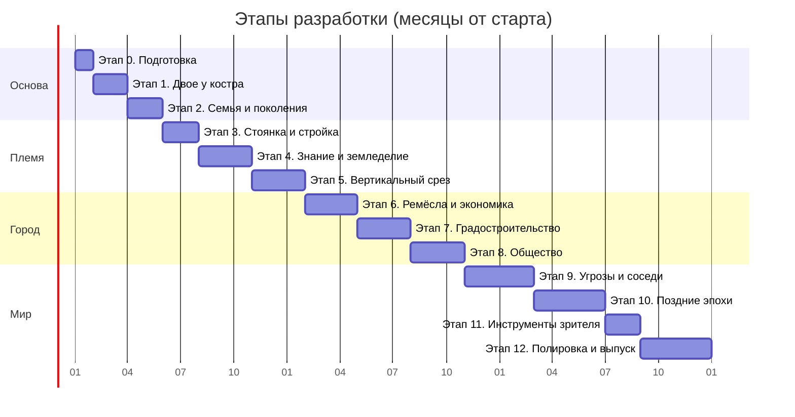

# 14. Дорожная карта

## 14.1. Принципы разработки

1. **Сначала симуляция, потом красота.** Первые этапы делаются на серых заглушках. Если на квадратиках смотреть скучно, спрайты не спасут.
2. **Каждый этап — играбельная сборка.** После любого этапа игру можно запустить и наблюдать. Нет этапов «полгода ничего не видно».
3. **От одного человека к обществу.** Каждая система сначала работает на двух жителях, потом на двадцати, потом на двухстах.
4. **Вертикальный срез раньше ширины.** Один биом и две эпохи в финальном качестве важнее шести эпох начерно.
5. **Автоматические прогоны с первого дня.** Игра без игрока обязана уметь проигрываться без графики на высокой скорости: сто миров за ночь, утром — таблица с итогами. Это главный инструмент баланса.
6. **Данные отдельно от кода.** Ресурсы, здания, технологии, черты, сценки — в таблицах. Добавление нового горшка не должно требовать программиста.
7. **У каждого шага есть критерий готовности** — наблюдаемое поведение, а не «сделано 80 %».

Сроки указаны для небольшой команды (программист, художник, геймдизайнер, часть ставки звукорежиссёра) и носят ориентировочный характер. Для одиночной разработки их стоит умножать на два-три и резать объём по разделу 14.4.

## 14.2. Общая схема

Итого около трёх лет до выпуска первой версии; ранний доступ возможен после этапа 8.

## 14.3. Этапы по шагам

### Этап 0. Подготовка (1 месяц)

| Шаг | Что делаем | Критерий готовности |
|-----|-----------|---------------------|
| 0.1 | Выбор движка и языка, настройка репозитория и сборки | Пустое окно собирается одной командой |
| 0.2 | Ядро: цикл тиков, отделённый от отрисовки; детерминированный генератор случайных чисел | Одно зерно дважды даёт побайтно одинаковое состояние через 10 000 тиков |
| 0.3 | Формат таблиц данных и их загрузка | Новый ресурс добавляется строкой в таблице |
| 0.4 | Запуск без графики и сбор статистики в файл | Сто прогонов по 10 лет завершаются скриптом, итог — таблица |
| 0.5 | Сохранение и загрузка состояния | Загруженный мир продолжается так же, как непрерывный |
| 0.6 | Лист стиля: палитра, три пробных тайла, один житель, один шалаш | Утверждён эталон, по которому рисуется всё остальное |

### Этап 1. Двое у костра (2 месяца)

Цель: два человека выживают в маленьком лесу, и на это уже любопытно смотреть.

| Шаг | Что делаем | Критерий готовности |
|-----|-----------|---------------------|
| 1.1 | Плоская карта 64×64: трава, деревья, вода, кусты | Камера двигается и приближается |
| 1.2 | Житель-заглушка, поиск пути, ходьба | Идёт к указанной точке в обход воды |
| 1.3 | Сытость и жажда; ягодные кусты; питьё из реки | Сам находит еду и воду, не умирает неделю |
| 1.4 | Сон и суточный цикл со сменой освещения | Ночью оба спят, утром встают |
| 1.5 | Предметы как физические объекты: подобрать, нести, положить, куча | Ветки складываются в кучу у стоянки |
| 1.6 | Полезностный выбор действий с короткими планами | Голодный бросает работу, сытый доделывает |
| 1.7 | Костёр: развести, подкладывать дрова, тепло и свет | Ночью сидят у огня; без дров он гаснет |
| 1.8 | Тепло, сезоны, простая погода | Зимой мёрзнут без костра и умирают — причина записана |
| 1.9 | Истощение и возобновление кустов | Через сезон идут за ягодами дальше |
| 1.10 | Пузырьки мыслей и первые анимации заглушек | Без меню понятно, чего хочет каждый |

**Проверка этапа:** посторонний человек смотрит пять минут и верно пересказывает, что происходило.

### Этап 2. Семья и поколения (2 месяца)

Цель: двое становятся родом; работает смена поколений.

| Шаг | Что делаем | Критерий готовности |
|-----|-----------|---------------------|
| 2.1 | Анкета жителя: имя, возраст, родство | Карточка открывается по щелчку |
| 2.2 | Отношения и разговоры | Проводящие время вместе сближаются |
| 2.3 | Пара, беременность, роды, младенец | Рождается первый ребёнок, мать носит его на руках |
| 2.4 | Взросление по стадиям, детское поведение | Ребёнок играет, подросток помогает |
| 2.5 | Генетика внешности и задатков | Дети похожи на родителей; иногда всплывает скрытый признак |
| 2.6 | Черты характера и их влияние на выбор действий | Ленивого и трудягу можно отличить по поведению |
| 2.7 | Навыки и обучение у старших | Сын охотника охотится лучше сверстников |
| 2.8 | Старение, смерть, погребение, траур | Появляется первая могила, близкие приходят к ней |
| 2.9 | Странники и запрет близкородственных браков | В третьем поколении браки заключаются только с неродными |
| 2.10 | Родословное древо и первая версия летописи | Видна история рода от первой пары |
| 2.11 | Автопрогоны на сто лет | Не менее 70 % родов живы через сто лет, население 15–40 |

### Этап 3. Стоянка и стройка (2 месяца)

| Шаг | Что делаем | Критерий готовности |
|-----|-----------|---------------------|
| 3.1 | Орудия: рубило, нож, копьё, корзина; мастерская на земле | С корзиной несут вдвое больше |
| 3.2 | Доска нужд и раздача задач | Нехватка дров порождает заготовку сама |
| 3.3 | Стройка по стадиям: разметка, подвоз, каркас, крыша | Шалаш вырастает на глазах |
| 3.4 | Домохозяйства: кто где живёт, заявка молодой семьи на жильё | Новая пара ставит свой шалаш |
| 3.5 | Карта притягательности для жилья | Шалаши встают кольцом у костра, не в воде и не в чаще |
| 3.6 | Износ земли и тропы | От костра к реке протаптывается тропа, заброшенная зарастает |
| 3.7 | Животные: стадо оленей, зайцы, рыба | Популяции растут и убывают от промысла |
| 3.8 | Охота, разделка, жарка, порча мяса | Охотники приносят тушу, все сходятся есть |
| 3.9 | Хищники и реакции жителей | Волки зимой подходят к лагерю, огонь их держит |
| 3.10 | Выделка шкур, одежда, шитьё | Одетые зимой мёрзнут меньше, это видно на спрайте |

### Этап 4. Знание и земледелие (3 месяца)

Цель: главный перелом — стоянка сама становится оседлым племенем.

| Шаг | Что делаем | Критерий готовности |
|-----|-----------|---------------------|
| 4.1 | Технологии как данные: предпосылки, шкала, источники прогресса | Огонь открывается из события, а не выдан на старте |
| 4.2 | Открытие конкретным жителем, сценка озарения, запись в летописи | У открытия есть автор |
| 4.3 | Распространение знания по знакомствам | Слой показывает, кто уже умеет |
| 4.4 | Нужда как ускоритель; вместимость культуры; утрата знания | Гибель единственного умельца отбрасывает прогресс |
| 4.5 | Вся эпоха 0 древа технологий | Десять открытий достижимы в прогонах |
| 4.6 | Плодородие, поля, стадии роста, сезонный цикл работ | Поле желтеет к осени, урожай собран до снега |
| 4.7 | Хранение: навес, яма, амбар; порча по условиям | Запас на зиму решает, кто доживёт до весны |
| 4.8 | Гончарство, глина, обжиг | Горшки сушатся у хижин, зерно лежит дольше |
| 4.9 | Приручение: собака, козы, загон, пастух | Стадо уходит на пастбище и возвращается |
| 4.10 | Землянка и хижина, улучшение дома на месте | Шалаш перестраивается, не исчезая |
| 4.11 | Старейшина и совет; первый обряд и праздник урожая | К старшему идут с ссорой; осенью общий пир |
| 4.12 | Автопрогоны на двести лет | Земледелие открыто в 80 % миров к 40-му году |

### Этап 5. Вертикальный срез (3 месяца)

Цель: эпохи 0–I в лесном биоме в качестве, близком к финальному. Это витрина проекта и момент решения, стоит ли идти дальше.

| Шаг | Что делаем | Критерий готовности |
|-----|-----------|---------------------|
| 5.1 | Настоящая генерация мира: высоты, климат, реки, недра, выбор старта | Карта 256×256 выглядит правдоподобно на любом зерне |
| 5.2 | Конструктор жителя из слоёв | Не встречается двух одинаковых людей |
| 5.3 | Финальная графика тайлов, деревьев, зданий эпох 0–I | Заглушек в кадре не осталось |
| 5.4 | Полный набор анимаций труда и быта для этих эпох | Каждое действие имеет свою анимацию |
| 5.5 | Сезонные палитры, ночь, дождь, снег, следы на снегу | Сезон узнаётся по одному кадру |
| 5.6 | Первые 30 сценок | За десять минут зритель видит не меньше трёх |
| 5.7 | Звук: эмбиент по слоям, маркеры, одна музыкальная тема | Картинка с закрытыми глазами всё ещё «читается» |
| 5.8 | Интерфейс: карточка жителя, летопись, скорость, слои | Новичок осваивается без подсказок |
| 5.9 | Закрытый показ 10–20 зрителям | Среднее время добровольного просмотра — от 30 минут |

**Решающая проверка проекта.** Если на этом этапе смотреть неинтересно, дальнейшее расширение не поможет: нужно возвращаться к поведению жителей и сценкам, а не добавлять эпохи.

### Этап 6. Ремёсла и экономика (3 месяца)

| Шаг | Что делаем | Критерий готовности |
|-----|-----------|---------------------|
| 6.1 | Цепочки из нескольких звеньев и мастерские | Хлеб проходит путь от поля до стола |
| 6.2 | Качество вещей и износ инструмента | Мастер делает заметно лучшие вещи |
| 6.3 | Специализация: от склонности до профессионала | При излишке еды появляется первый гончар |
| 6.4 | Ученичество и ремесленные династии | Мастерская переходит к ученику или сыну |
| 6.5 | Медь, бронза, рудник, углежоги, кузня | Лес у плавильни редеет на глазах |
| 6.6 | Колесо, телега, тягло, возчики | Телеги идут только по достаточно широкой дороге |
| 6.7 | Собственность семьи, обмен, долг | Гончар меняет горшки на зерно |
| 6.8 | Ткачество, крашение, одежда эпохи II | Толпа становится цветной |
| 6.9 | Вся эпоха II древа технологий и её здания | Деревня в 100 жителей устойчива в прогонах |
| 6.10 | Упрощённая симуляция за экраном | 300 жителей без падения скорости |

### Этап 7. Градостроительство (3 месяца)

| Шаг | Что делаем | Критерий готовности |
|-----|-----------|---------------------|
| 7.1 | Участки и фасады к улице | Дома выстраиваются вдоль главной тропы |
| 7.2 | Карты притягательности для всех типов зданий | Кузня на отшибе, амбар на сухом, дубильня у воды |
| 7.3 | Защита дорог от застройки, мощение по нагрузке | Самая людная улица мостится первой |
| 7.4 | Площадь, колодец, рынок на перекрёстке | Центр возникает сам |
| 7.5 | Мосты и броды | Мост встаёт там, где чаще всего переходили |
| 7.6 | Ветхость, ремонт, руины, разбор | Брошенный дом зарастает и разбирается |
| 7.7 | Перенос и снос зданий, плохо стоящих | Поле посреди деревни уступает место домам |
| 7.8 | Ограда и ворота по границе застройки | Ворота на самых нагруженных дорогах |
| 7.9 | Пожар, его распространение и тушение цепочкой | Квартал отстраивается по новым технологиям |
| 7.10 | Имена улиц и мест из летописи | Названия объяснимы событиями |
| 7.11 | Выселки и дочерние поселения | Избыток семей основывает хутор |
| 7.12 | Проверка на двадцати зёрнах | Планы городов разные, ни один не похож на сетку |

### Этап 8. Общество (3 месяца)

| Шаг | Что делаем | Критерий готовности |
|-----|-----------|---------------------|
| 8.1 | Авторитет, вождь, влияние его характера на приоритеты | Два вождя ведут одну деревню по-разному |
| 8.2 | Ухаживание, свадьба, сговор семей, наследование | Свадьба — событие для всей улицы |
| 8.3 | Вера из событий ранней летописи: тотем, миф, святыня | У каждого мира свой миф о начале |
| 8.4 | Календарь праздников | В праздник никто не работает, площадь полна |
| 8.5 | Обычаи, проступки, репутация, суд старейшины | Вора сторонятся |
| 8.6 | Вражда и дружба родов, генератор личных историй | В летописи появляются истории на несколько поколений |
| 8.7 | Недовольство и его ступени | Голод и поборы приводят к ропоту, затем к бунту |
| 8.8 | Письменность, законы как ответ на события | После пожара принимается противопожарный закон |
| 8.9 | Рынок, монета, цены, налоги, казна | Дефицит товара рождает новых мастеров через сезон |
| 8.10 | Сословия и их внешние признаки | Достаток виден по дому и одежде |
| 8.11 | Эпоха III целиком | Городок в 300 жителей устойчив |

**Возможная точка раннего доступа:** четыре эпохи, один-два биома, мирная жизнь с хищниками и бедствиями.

### Этап 9. Угрозы, война, соседи (4 месяца)

| Шаг | Что делаем | Критерий готовности |
|-----|-----------|---------------------|
| 9.1 | Бедствия с предвестниками: потоп, засуха, суровая зима | Общество после потопа не строит в пойме |
| 9.2 | Болезни и эпидемии, зависящие от плотности и воды | Мор виден на графике и на кладбище |
| 9.3 | Режиссёр событий | Нет ни череды катастроф подряд, ни полувекового застоя |
| 9.4 | Бой: оружие, броня, мораль, раны | Стычка читается без пояснений |
| 9.5 | Ополчение, дружина, тренировки | У ворот появляется плац |
| 9.6 | Соседи в статистическом режиме и их разворачивание | Сосед развивается, пока на него не смотрят |
| 9.7 | Отношения, торговля, караваны, послы | Караван приносит новую культуру или ремесло |
| 9.8 | Набеги и тревога | По набату все бегут за ограду |
| 9.9 | Поход, битва отрядами, отступление | Потерявший командира отряд бежит |
| 9.10 | Осада и разрушение стен | Запасы в осаждённом городе тают на глазах |
| 9.11 | Последствия: пленные, дань, руины, памятники, яма в пирамиде | Война видна в городе через поколение |
| 9.12 | Сдерживание войн: расчёт выгоды и усталость | В прогонах войны идут не чаще раза в поколение |

### Этап 10. Поздние эпохи и биомы (4 месяца)

| Шаг | Что делаем | Критерий готовности |
|-----|-----------|---------------------|
| 10.1 | Эпоха IV: камень, мельницы, гильдии, собор как многолетняя стройка | Собор растёт десятилетиями, с лесами и кранами |
| 10.2 | Стены, посад, вторая стена | У города видны кольца роста |
| 10.3 | Формы правления и смена власти | Республика, монархия и теократия возникают из разных условий |
| 10.4 | Организованная религия, монастыри, школы | Монастырь переписывает книги и лечит |
| 10.5 | Эпоха V: печать, наука, порох, банк, регулярная планировка | Новые кварталы прямые, старый центр кривой |
| 10.6 | Государство из нескольких поселений | Столица связана дорогами с городами |
| 10.7 | Оставшиеся базовые биомы с архитектурой | Шесть биомов дают шесть разных обликов |
| 10.8 | Карта 512×512 и производительность на 1500 жителей | Стабильная скорость на среднем компьютере |
| 10.9 | Графика и анимации эпох II–V | Заглушек не осталось |

### Этап 11. Инструменты зрителя (2 месяца)

| Шаг | Что делаем | Критерий готовности |
|-----|-----------|---------------------|
| 11.1 | Летопись трёх уровней, меняющая стиль с эпохой | По записи камера летит к месту события |
| 11.2 | Биографии жителей из памяти событий | Текст читается как связный рассказ |
| 11.3 | Слежение, закладки, уведомления | Можно прожить игру глазами одного рода |
| 11.4 | Режиссёрская камера | Час без касаний мыши не скучен |
| 11.5 | Все слои-линзы и статистика | На любой вопрос «почему» есть слой с ответом |
| 11.6 | Ежегодные снимки и таймлапс | Рост от костра до города показывается за минуту |
| 11.7 | «Тогда и сейчас», фоторежим, выгрузка роликов | Результатом легко поделиться |
| 11.8 | Библиотека сценок до 150 | За час зритель не видит повторов подряд |

### Этап 12. Полировка и выпуск (4 месяца)

| Шаг | Что делаем | Критерий готовности |
|-----|-----------|---------------------|
| 12.1 | Баланс на тысячах автопрогонов | Показатели раздела 13.5 выполняются |
| 12.2 | Вторичные анимации, вариации домов, мелкие детали | У каждого типа дома не меньше трёх обликов |
| 12.3 | Адаптивная музыка по эпохам и событиям | Смена эпохи слышна |
| 12.4 | Торжественная подача вех | Первый костёр и тысячный житель запоминаются |
| 12.5 | Настройки мира: размер, суровость, частота бедствий, число соседей | Игрок собирает мир под себя |
| 12.6 | Обучающие подсказки без текста-простыни | Новичок понимает слои и летопись за пять минут |
| 12.7 | Оптимизация, совместимость сохранений, отлов ошибок | Сутки непрерывной работы без сбоев |
| 12.8 | Локализация, доступность (масштаб интерфейса, режим для дальтоников) | Готовы основные языки |
| 12.9 | Открытый тест и выпуск | — |

### После выпуска

Биомы расширения по очереди из раздела 3.4, эпоха VI, режим Провидения, обмен зёрнами миров и летописями между игроками, поддержка пользовательских таблиц данных.

## 14.4. Что резать, если не хватает сил

Порядок сокращения от наименее болезненного:

1. Эпоха V и государство из нескольких городов — переносятся в дополнение.
2. Полевые битвы и осады заменяются набегами и абстрактным расчётом исхода.
3. Число базовых биомов сокращается до трёх: лес, равнина, река.
4. Денежный рынок с плавающими ценами заменяется обменом.
5. Формы правления сводятся к двум: совет и вождь.

**Не резать ни при каких условиях:** физические предметы и видимый труд, генетику и родословные, тропы из износа, открытия из практики, летопись, сценки. Это ядро зрелища.
